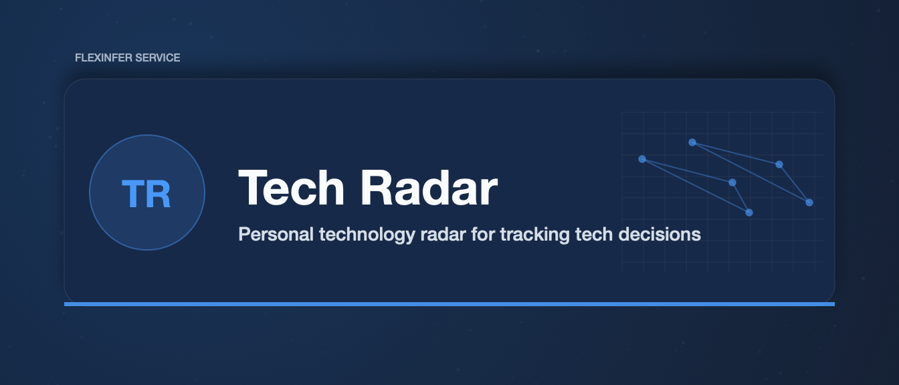

# Tech Radar

Personal technology radar for tracking tech decisions across projects.

## Overview

Inspired by [ThoughtWorks Tech Radar](https://www.thoughtworks.com/radar), this tool helps you:

- **Track Decisions**: Record which technologies you've adopted, are trialing, or have rejected
- **Auto-Discover**: Scan projects for dependencies and infer technology usage
- **Visualize**: Interactive radar visualization
- **Document**: Capture reasoning behind decisions

## Features

- **YAML-based Data**: Easy to edit and version control
- **Auto-population**: Scan package.json, go.mod, pyproject.toml
- **Interactive Radar**: SVG/HTML visualization
- **Decision Log**: Timestamp and reasoning for each entry
- **Cross-project Analysis**: Aggregate across multiple repos

## Quadrants

Technologies are organized into quadrants:

1. **Languages & Frameworks**: Python, Go, React, etc.
2. **Tools**: Docker, Terraform, K8s operators
3. **Platforms**: AWS, GCP, K8s, Cloudflare
4. **Techniques**: GitOps, TDD, Event sourcing

## Rings

Each technology is placed in a ring:

- **Adopt**: Use by default for appropriate problems
- **Trial**: Worth pursuing; understand trade-offs
- **Assess**: Worth exploring; not yet recommended
- **Hold**: Proceed with caution; actively migrating away

## Installation

```bash
go install gitlab.flexinfer.ai/services/tech-radar/cmd/radar@latest
```

## Usage

### Initialize Radar

```bash
radar init
# Creates .tech-radar/ directory with config and data files
```

### Add Entry

```bash
# Interactive
radar add

# Or directly
radar add --name "React" --quadrant "frameworks" --ring "adopt" \
  --reason "Primary frontend framework"
```

### Scan Projects

```bash
# Scan current project
radar scan .

# Scan multiple projects
radar scan /path/to/project1 /path/to/project2

# Auto-add discovered technologies
radar scan . --auto-add
```

### Generate Visualization

```bash
# Generate static HTML
radar render --output radar.html

# Serve interactive version
radar serve --port 8088
```

## Data Format

```yaml
# .tech-radar/radar.yaml
meta:
  name: "Personal Tech Radar"
  updated: 2024-01-15

entries:
  - name: Go
    quadrant: languages
    ring: adopt
    description: Primary backend language
    moved: 0  # 0 = no change, 1 = moved in, -1 = moved out
    history:
      - date: 2023-01-01
        ring: trial
        reason: Evaluating for CLI tools
      - date: 2023-06-01
        ring: adopt
        reason: Proven for services and CLIs

  - name: Rust
    quadrant: languages
    ring: trial
    description: Evaluating for performance-critical code
    moved: 1
    history:
      - date: 2024-01-01
        ring: trial
        reason: Learning for Tauri apps

  - name: Python 2
    quadrant: languages
    ring: hold
    description: Legacy, migrating to Python 3
    moved: 0
```

## Configuration

```yaml
# .tech-radar/config.yaml
scan:
  # Files to scan for dependencies
  files:
    - package.json
    - go.mod
    - pyproject.toml
    - Cargo.toml
    - requirements.txt
    - .mcp.json
    - mcp.json
    - claude_desktop_config.json
    - cline_mcp_settings.json

  # Mappings from package names to radar entries
  mappings:
    react: { name: React, quadrant: frameworks }
    typescript: { name: TypeScript, quadrant: languages }
    openai: { name: OpenAI API, quadrant: platforms }
    "@anthropic-ai/sdk": { name: Claude API, quadrant: platforms }
    "@modelcontextprotocol/sdk": { name: Model Context Protocol, quadrant: tools }
    "github.com/mark3labs/mcp-go": { name: mcp-go, quadrant: tools }

visualization:
  colors:
    adopt: "#93c47d"
    trial: "#93d2c2"
    assess: "#fbdb84"
    hold: "#efafa9"
```

The scanner now understands common MCP config files as repo-local discovery signals, so AI/agentic tooling can show up in project scans even when it is configured outside a language manifest.

## Architecture

```
cmd/radar/main.go         # CLI entrypoint
internal/
  scanner/                # Project scanning
  radar/                  # Radar data management
pkg/types/                # Shared types
web/                      # Frontend (Svelte)
```

## Visualization

The radar is rendered as an interactive SVG with:
- Hover tooltips with entry details
- Click to expand history
- Filter by quadrant/ring
- Search functionality

## Integration with py-git-chronicles

Cross-reference with git history to see when technologies were introduced:

```bash
radar timeline --tech "React"
# Shows commits that introduced React and related changes
```

## Development

```bash
# Build CLI
make build

# Run dev server
make dev

# Build frontend
cd web && pnpm build
```

## License

MIT
